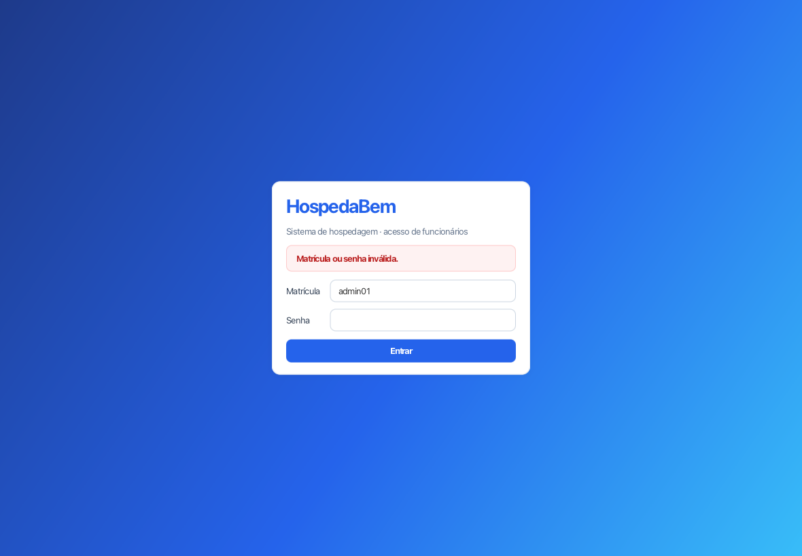
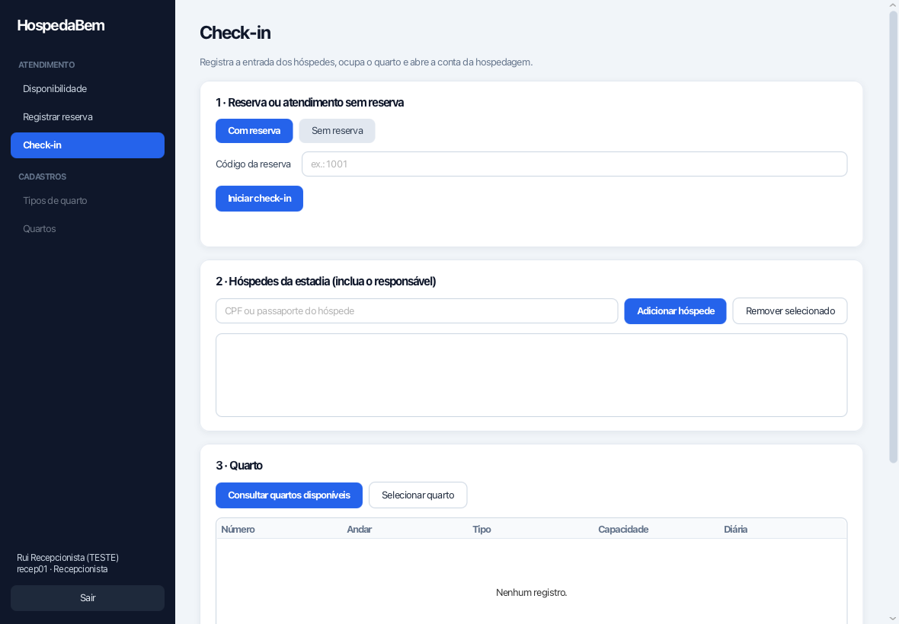
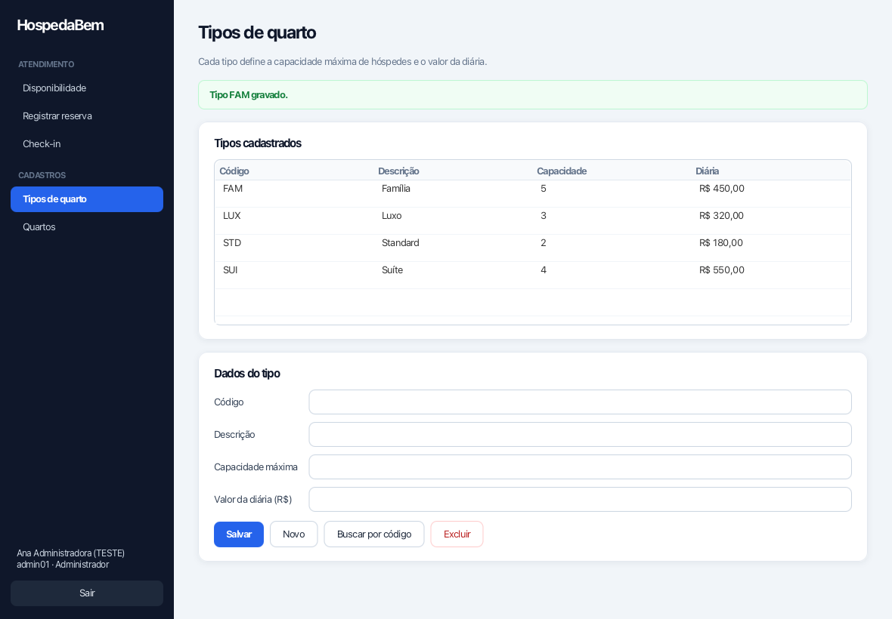
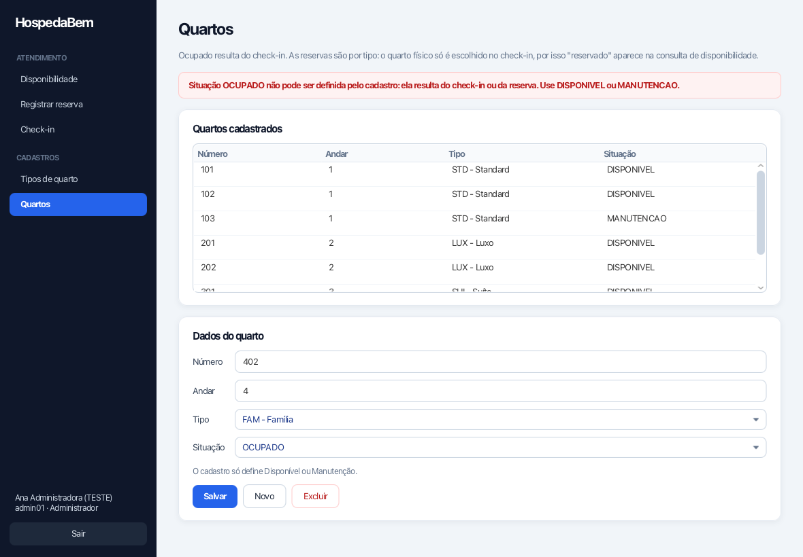
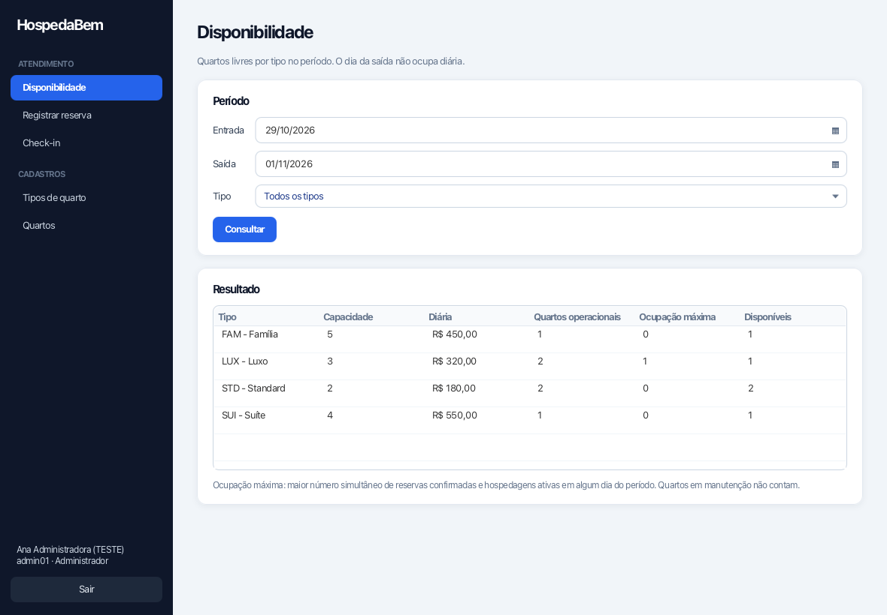
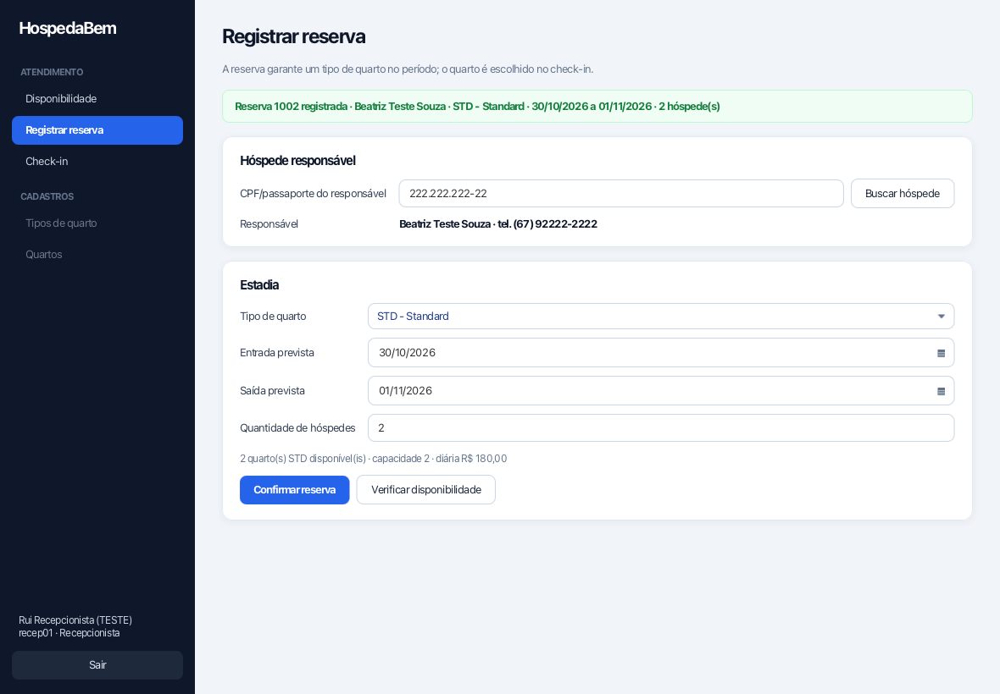
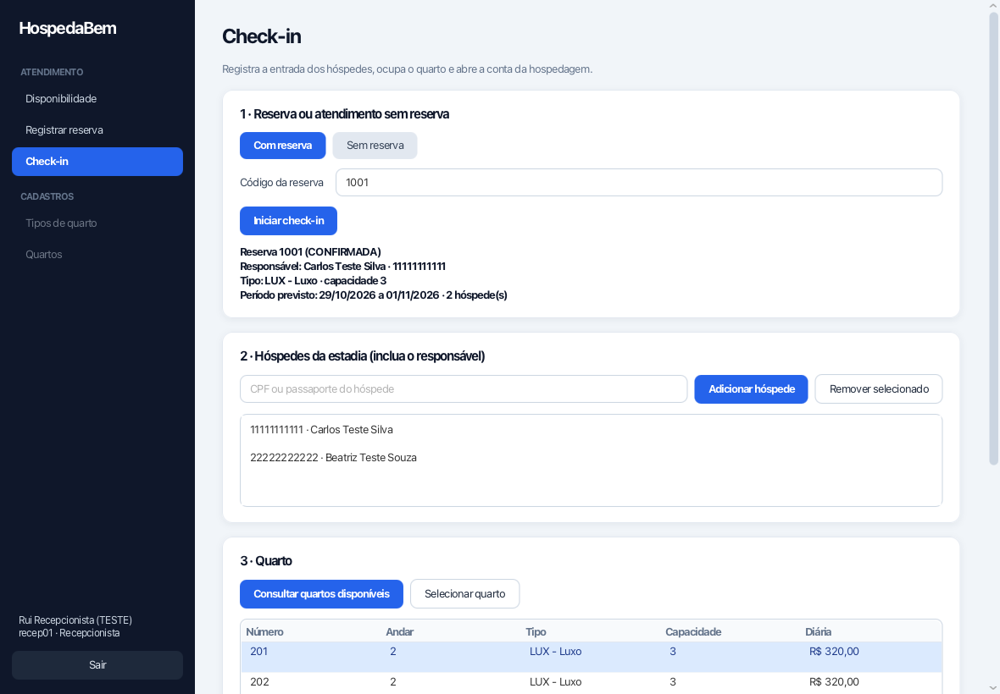
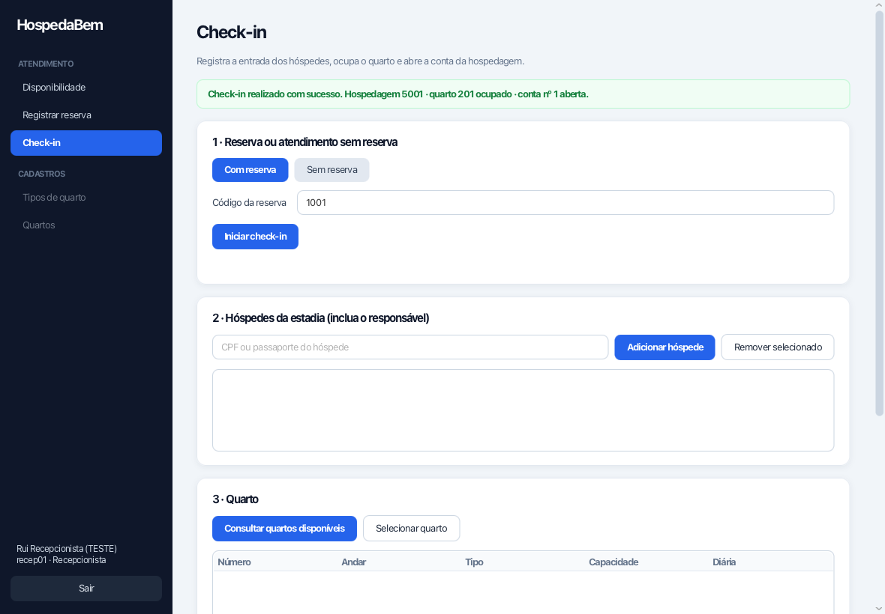

# Demonstração das telas reais (29/10/2026)

## Como é executada

As telas JavaFX reais são operadas pelos testes de ponta a ponta [`TelasE2E`](../src/test/java/hospedabem/view/TelasE2E.java), com o auxiliar [`RoboFx`](../src/test/java/hospedabem/view/RoboFx.java). O robô localiza campos pelo rótulo e botões pelo texto, aciona-os na thread do JavaFX e espera as tarefas de banco terminarem. Em seguida, cada teste confere a mensagem exibida e o estado do PostgreSQL de teste.

```bash
mvn test -Dtest=TelasE2E -Dhb.e2e.capturas=docs/telas
```

Para usar a aplicação de verdade: `java -jar target/hospedabem.jar`.

**Limitação:** isso não substitui o vídeo com interação humana. Para gravá-lo, siga [roteiro-demonstracao.md](roteiro-demonstracao.md).

## Mensagens conferidas pelos testes

| Cenário | Mensagem na tela |
|---|---|
| Login com senha errada | Matrícula ou senha inválida. |
| Recepcionista | "Tipos de quarto" e "Quartos" desabilitados no menu |
| Inclusão do tipo FAM | Tipo FAM gravado. |
| Tipo com código STD repetido | Já existe tipo de quarto com o código STD. |
| Inclusão do quarto 401 | Quarto 401 gravado. |
| Quarto com situação OCUPADO pelo cadastro | Situação OCUPADO não pode ser definida pelo cadastro: ela resulta do check-in ou da reserva. Use DISPONIVEL ou MANUTENCAO. |
| Disponibilidade com saída = entrada | Período inválido: a saída deve ser posterior à entrada. |
| Reserva STD com 3 hóspedes | Quantidade de hóspedes (3) excede a capacidade do tipo STD (2). |
| Reserva válida (recepcionista) | Reserva 1002 registrada · Beatriz Teste Souza · STD - Standard · ... · 2 hóspede(s) |
| Check-in 1001: hóspede repetido | Hóspede já informado: Carlos Teste Silva. |
| Check-in 1001: CPF inexistente | Hóspede não cadastrado: 99999999999. O cadastro de hóspedes (UC06) será entregue na iteração 2; ... |
| Check-in 1001 confirmado | Check-in realizado com sucesso. Hospedagem 5001 · quarto 201 ocupado · conta nº 1 aberta. |
| Reiniciar o check-in da reserva 1001 | Reserva 1001 está convertida e não permite check-in. |
| Check-in sem reserva: 3º hóspede em STD | Capacidade do quarto excedida: o tipo STD comporta 2 hóspede(s). |
| Check-in sem reserva confirmado | Check-in realizado com sucesso. Hospedagem 5001 · quarto 101 ... |

Depois de cada fluxo, os testes conferem no banco: o funcionário da sessão gravado na reserva, o quarto `OCUPADO`, a reserva `CONVERTIDA` (ou nenhuma reserva criada no caso sem reserva), a conta `ABERTA` e a quantidade de hóspedes da hospedagem.

## Capturas

| | |
|---|---|
|  |  |
|  |  |
|  |  |
|  |  |
