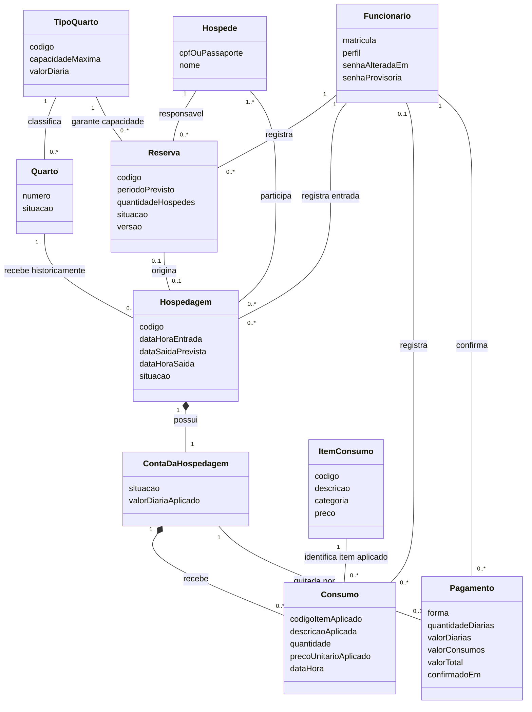

# Modelo conceitual — iteração 2

Revisão do modelo da atividade F para os RF-8–23 e os casos de uso até UC12. Os nomes abaixo são conceitos de negócio; classes técnicas e DAOs estão no [projeto](projeto.md).

Uma reserva pode nunca gerar hospedagem; uma hospedagem pode começar sem reserva. Um quarto recebe várias hospedagens no histórico, mas apenas uma pode estar ativa. O vínculo funcionário–consumo admite ausência somente para lançamentos históricos anteriores à migração UC11; novos lançamentos identificam o funcionário da sessão.

## Invariantes e decisões

- Reserva é por **tipo**, não por quarto físico. Só `CONFIRMADA` pode ser alterada/cancelada; `CANCELADA` e `CONVERTIDA` preservam histórico. Alterações incrementam `versao` e revalidam a capacidade do período, excluindo a própria reserva do cálculo.
- O check-in abre uma única conta `ABERTA`, preservando a diária vigente. A conta recebe lançamentos apenas com hospedagem `ATIVA`.
- Consumo guarda código, descrição e preço aplicados no lançamento; editar o catálogo não recalcula o histórico. Quantidade de 1 a 999 é decisão da equipe.
- Pagamento existe somente depois da confirmação do usuário. Uma conta tem no máximo um pagamento; quitação, encerramento da hospedagem e liberação do quarto são atômicos.
- Diárias por noites efetivas, mínimo de uma, sem multa por atraso e sem acréscimo por horário: decisão da equipe em `RegraDiarias`, não detalhamento dado pelo RF-20.
- Senha provisória no primeiro acesso e renovação a cada 90 dias: política da equipe em `PoliticaDeSenha`; RNF-8 pede periodicidade, sem fixar prazo ou composição.

O modelo não adiciona transação bancária ou autorização de adquirente: o sistema registra a confirmação feita pelo funcionário. As estruturas de relatório/impressão dos UC13–18 não fazem parte desta revisão.
