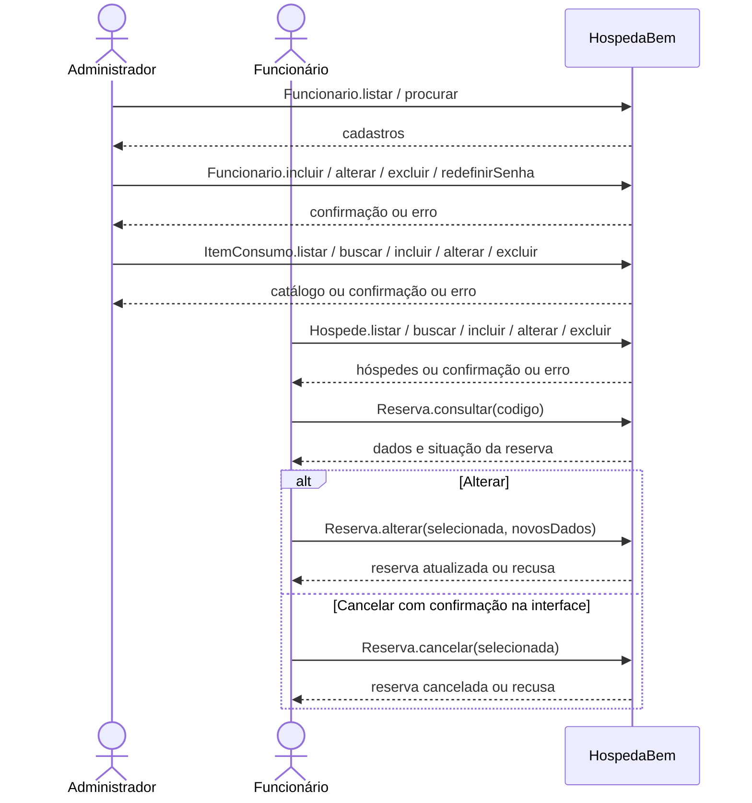
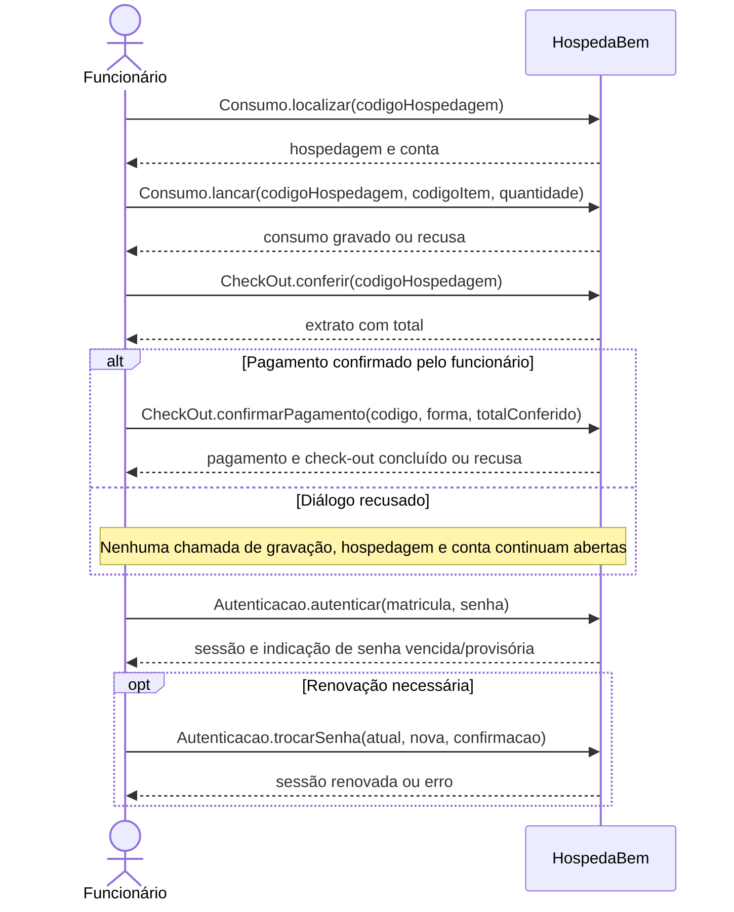

# DSS e contratos de operação — iteração 2

Os eventos do DSS descrevem a fronteira do sistema; os nomes são os dos métodos dos controladores, com argumentos abreviados. A navegação gráfica não é uma operação persistente. Referências: RF-2/3/5/6/8/11/12/16/19–23 e RNF-8/10/12.

## DSS — cadastros e reserva

## DSS — consumo, pagamento e senha

## Contratos

As pré-condições comuns são sessão autenticada, senha válida e perfil autorizado. A troca da própria senha é permitida com senha vencida; cadastros de funcionário e item exigem administrador. Todas as falhas preservam o estado persistido da operação.

| Operação | Pré-condições e validação | Pós-condições de sucesso |
|---|---|---|
| UC02 salvar/excluir/redefinir senha | Autor reconferido como administrador no banco; dados e unicidade válidos; proibições de autoexclusão/autorrebaixamento/último administrador e histórico respeitadas. | Funcionário incluído/alterado/excluído; senha inicial/redefinida armazena hash e fica provisória. |
| UC05 salvar/excluir | Item válido e código único; exclusão sem consumo vinculado. | Catálogo atualizado; histórico dos consumos inalterado. |
| UC06 salvar/excluir | Dados válidos, documento único; cadastro selecionado ainda atual; exclusão sem reserva/hospedagem vinculada. | Cadastro persistido ou excluído sem eliminar histórico. |
| UC09 consultar | Código existente. | Retorna dados e situação; nenhuma gravação. |
| UC09 alterar | Reserva `CONFIRMADA` com mesmo estado/versão da seleção; responsável/tipo válidos; capacidade e disponibilidade válidas; nova entrada não retrocede para o passado. | Dados atualizados e versão incrementada; nova capacidade ocupada e antiga devolvida conforme período/tipo. |
| UC09 cancelar | Reserva `CONFIRMADA` com mesmo estado/versão da seleção; confirmação feita na interface. | Situação `CANCELADA`, versão incrementada, histórico preservado e capacidade devolvida. |
| UC11 lançar | Hospedagem `ATIVA`, conta `ABERTA`, item existente, quantidade 1–999. | Consumo associado à conta e item; código/descrição/preço aplicados, quantidade, data/hora e funcionário preservados; total = preço × quantidade. |
| UC12 conferir | Hospedagem `ATIVA` e conta `ABERTA`. | `Extrato` com diárias efetivas + consumos, sem gravar pagamento/saída. |
| UC12 confirmar pagamento | Forma válida, total conferido informado e igual ao recalculado sob trava; hospedagem/conta ainda abertas. | Um pagamento associado à conta, com forma, totais, quantidade de diárias, funcionário e instante; conta `FECHADA`, hospedagem `ENCERRADA` com saída, quarto `DISPONIVEL`, tudo na mesma transação. |
| RNF-8 trocar senha | Funcionário autenticado; senha atual confere; composição, confirmação e diferença válidas; hash não mudou entre leitura e gravação. | Novo hash, `senha_alterada_em` atual e `senha_provisoria=false`; sessão liberada e vencimento renovado. |

## Evidência dos efeitos e concorrência

- `ReservaIT`, `ConcorrenciaIT` e `CheckInIT`: alteração/cancelamento e conversão não aplicam mudanças sobre seleção desatualizada.
- `ConsumoIT` e `CheckOutIT`: snapshots de preço, conta encerrada, total divergente, consumo × fechamento, confirmação duplicada e rollback por falha na liberação do quarto.
- `TrocaSenhaIT`: prazo, bloqueio e troca; `MigracaoIteracaoUmIT`: compatibilidade dos dados antigos; `TelasE2E.cicloCompletoDaIteracaoDoisPelasTelas`: sequência operacional pela interface.

Resultado executado e limites da verificação estão no [relatório da #9](../validacao-iteracao-2.md). Os diagramas não substituem a distinção entre execução local e CI.
