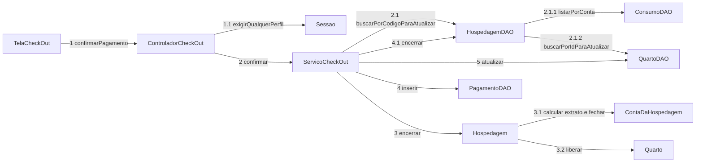
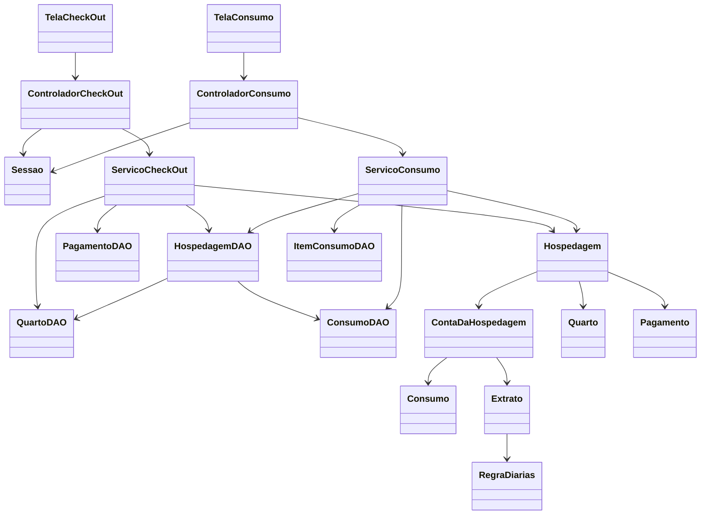

# Comunicação e classes de projeto — iteração 2

Os nomes abaixo correspondem a `src/main/java/hospedabem`. A implementação mantém MVC com serviços e DAOs separados: autorização nos controladores/`Sessao`, regras nos objetos de domínio, transações nos serviços e SQL nos DAOs. Esses serviços/DAOs integram o model no sentido amplo do material da disciplina; não são classes de interface.

## Comunicação — confirmação do check-out

O recorte abaixo mostra os objetos e a ordem das mensagens do UC12. As mensagens 2–5 ocorrem somente após a confirmação do diálogo; o service abre uma transação. A hospedagem e a conta são travadas antes do quarto. As regras de negócio decidem o encerramento; os DAOs persistem seus efeitos.

`HospedagemDAO` carrega os consumos antes de buscar/travar o quarto. Um lançamento UC11 usa `buscarParaLancamento` e trava a mesma hospedagem/conta. Depois do fechamento ele encontra conta fechada; uma segunda confirmação não gera outro pagamento. O banco também exige `UNIQUE` por conta em `pagamento`.

## Classes de projeto — núcleo transacional

`Pagamento` é um record com forma, `Extrato` e instante da confirmação; o DAO desdobra os totais do extrato nas colunas SQL. Não há `ContaDaHospedagemDAO`: a conta é persistida junto da hospedagem por `HospedagemDAO`. `Extrato` é um valor calculado, sem tabela própria nem recurso de impressão nesta iteração.

## Demais colaboradores e responsabilidades

| Caso de uso | View → controller → service | Domínio e persistência |
|---|---|---|
| UC02 | `TelaFuncionario` → `ControladorFuncionario` → `ServicoFuncionario` | `Funcionario`, `PoliticaDeSenha`, `Senha`; `FuncionarioDAO`. Perfil do autor reconferido dentro da transação. |
| UC05 | `TelaItemConsumo` → `ControladorItemConsumo` → `ServicoItemConsumo` | `ItemConsumo`; `ItemConsumoDAO`. Catálogo e proteção do histórico. |
| UC06 | `TelaHospede` → `ControladorHospede` → `ServicoHospede` | `Hospede`; `HospedeDAO`. Validação da entrada e preservação de dados antigos. |
| UC09 | `TelaAlteracaoReserva` → `ControladorReserva` → `ServicoReserva` | `Reserva`, `SolicitacaoReserva`, `Periodo`, `Disponibilidade`; `ReservaDAO`, `TipoQuartoDAO`, `HospedeDAO`, `ServicoDisponibilidade`. Travas, versão e disponibilidade. |
| RNF-8 | `TelaLogin`/`TelaTrocaSenha` → `ControladorAutenticacao` → `ServicoAutenticacao` | `Sessao`, `Funcionario`, `PoliticaDeSenha`, `Senha`; `FuncionarioDAO`. Hash e troca condicional ao hash anterior. |

`InicializadorBanco` aplica as migrações da iteração 2 sobre o esquema existente ou novo; nenhuma view executa SQL. `App` fornece o relógio alinhado ao banco. Operações de interface são executadas via `Tarefa`, com mensagens de erro tratadas para o usuário.

UC13–UC18 (comprovantes e relatórios) permanecem fora deste projeto da iteração 2, conforme a atividade D.
